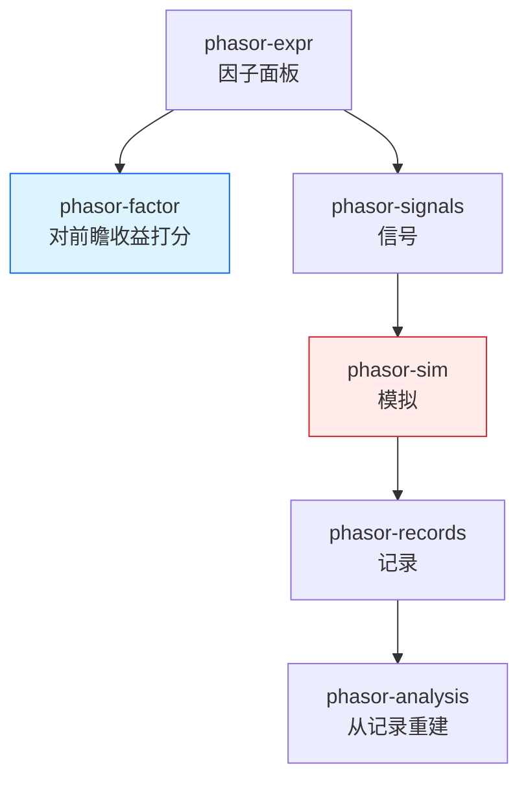

# phasor-factor

因子评估。它回答的不是“这笔交易赚了多少”，而是“这个因子排得对不对”。模拟还没开始，因子面板已经可以对着后面的收益打分。

> **核心特性：**
> - **不写记录、不改现金**：评估结果描述因子，不能流回信号
> - **前瞻收益故意读未来**：这是评分用的，不是交易用的
> - **线程不改变任何一位**：安慰剂的随机数是 `(seed, draw, row)` 的函数，和模拟里的拒单随机数同一套

<a id="why"></a>

## 为什么站在回测旁边，而不是回测里面

一次回测判断的是一个**策略**：信号进 `phasor-sim`，撮合写成记录，`phasor-analysis` 只从记录重建净值和夏普。这是对的，因为能改变现金或仓位的东西必须是一条记录，否则结果无法从记录里审计。

因子研究问的是另一个问题。一个动量、一个行业中性化之后的残差、一套 Alpha158，在送进模拟之前就该知道：它排的名次和后面的收益是不是一回事，排出来的分位是不是单调，换手是不是高到手续费吃掉，它是不是另一个因子的复制品。这些都不需要撮合。撮合会把手续费、冲击、资金约束和调仓规则混进同一个夏普里，因子本身有没有预测力反而看不清。

所以评估是回测旁边的一条路，不是回测的一个阶段。`phasor-expr` 算出因子面板，面板可以走向信号和模拟，也可以走向 `phasor-factor`。两条路不汇合：评估读到的未来价格留在评估里。



*说明：* 红色是会写记录的那条路。蓝色的评估不写记录。它依赖 `phasor-core`（面板、容差、计数器随机数）和 `phasor-analysis` 里的正态累积分布（Newey–West t 的 p 值），不依赖模拟。

<a id="future"></a>

## 什么读了未来

前瞻收益是 `close[t + lag + horizon] / close[t + lag] - 1`。`lag` 是知道因子之后多久才能成交，默认 1：因子印在第 `t` 根上，从下一根开始算收益。凡是拿这个收益去打分的函数都在读未来，而且是故意的。

| 读未来 | 只读因子自己的那根 K 线 |
|---|---|
| 前瞻收益、IC、秩 IC、分位收益、多空收益、单调性 | 分位标签 |
| Fama–MacBeth（左端是前瞻收益时） | 分位换手、秩自相关 |
| 安慰剂（它打分的就是上述 IC） | 中性化、因子之间的相关矩阵 |

分位标签是因子在当根 K 线上的名次，不知道后面的价格。用它去算换手，比的是这一根和更早的一根。中性化减掉的是当根的行业均值和暴露，不看收益。相关矩阵问的是两个因子像不像，也不看收益。

<a id="ic"></a>

## IC 与秩 IC

信息系数是因子和前瞻收益的相关系数，每个截面（一根 K 线、全部标的）算一个数，得到一条随时间走的序列。

- **IC** 是 Pearson，用的是值本身。量纲和极端值会拉动它。
- **秩 IC** 是 Spearman：两边各自取平均秩（并列取它们所占名次的平均，和 pandas `rank`、scipy `rankdata` 一样），再对秩做 Pearson。它问的是名次，这也是报告里默认拿去算 t 统计量的那条序列。

一条 IC 在两种情况下是 `NaN`：两边同时有限的标的少于 `min_names`（至少两个），或者其中一边是常数。常数的相关系数没有定义，这里和 scipy 一样只把精确相等当成常数，差一个舍入误差的序列仍有方差。

截面 IC 一次可以算多个因子对多个期限。因子在一根 K 线上的秩只算一次，供每个期限复用；两边缺失的标的不同时才对那一对重算。时间序列 IC 沿每个标的自己的历史算：整段样本、滚动窗口，或按区块（例如自然月）。滚动窗口停在当前这根，窗口里的前瞻收益却要等 `lag + horizon` 根之后才知道，所以滚动 IC 仍然是描述，不是信号。

<a id="nw"></a>

## Newey–West

把一条 IC 序列的均值除以它的标准误，得到 t 统计量。收益重叠的时候这个标准误会偏小：5 日收益和隔一天的 5 日收益共享四天，IC 自己是自相关的，独立假设下的 t 把同一段行情数了好几次。

Newey–West 用 Bartlett 权重估计长期方差，`γ₀ + 2 Σ_l (1 − l / (lags + 1)) γ_l`，没有小样本校正（statsmodels `HAC`，`use_correction=False`）。滞后至少是 `horizon − 1`，也至少是经验法则 `⌊4 (n / 100)^{2/9}⌋`。`t_nw` 是用这个方差替换普通方差之后的 t，`p_nw` 是它的双侧正态 p 值。

报告里 `ic` 是 Pearson 的均值，`rank_ic` 是 Spearman 的均值。`icir`、`t`、`t_nw`、`p_nw`、`hit`、`n` 描述的是秩 IC。`hit` 是秩 IC 严格大于 0 的比例。没有有限值时这些统计量是 `NaN`，`n` 是 0；序列是常数时，除了均值和 `n`，需要除以波动的那些也是 `NaN`。

<a id="quantiles"></a>

## 分位、单调性、换手

`quantile_labels` 在每一根 K 线上把标的分成 `q` 组，名次只来自这一根的因子。标签从 0 到 `q - 1`，缺失是 −1。它不读未来，所以可以拿去当持仓规则。

`quantile_returns` 才读未来：每一组在这一根上的前瞻收益（可加权）。`long_short_returns` 是最高组减最低组。`monotonicity` 是组号和各组平均收益的秩相关，问收益是不是顺着组往上走。各组均值相同的时候它是 `NaN`，因为那条序列是常数。

`quantile_turnover` 是相邻两根（间隔 `lag`）之间一组名次换了多少。`rank_autocorr` 是因子自己的秩隔 `lag` 根的相关。两者都只和过去比。换手高而秩 IC 只是勉强不为零，通常意味着模拟里的手续费会把这个因子吃掉——这正是评估要在模拟之前暴露出来的事。

`quantile_backtest` 是这一层里唯一真正跑模拟的函数：按分位标签持有，每隔 `rebalance` 根把一组调成等权，信号再滞后 `lag` 根。多空组是顶组做多、底组做空。它走 `from_orders`，现金和持仓的变化仍然是记录。

<a id="neutral"></a>

## 中性化

一个因子看起来能预测收益，有时只是因为它在行业上或市值上的暴露碰巧和收益的暴露一样。`neutralize` 在每一根 K 线上做一次最小二乘：组内去均值（行业固定效应的组内变换），再对给定的暴露取残差。和小于 1e−12 倍数量级的截面波动当成截距的舍入灰尘，不当成一个斜率。残差和暴露正交，也和组均值正交。

`evaluate` 收到 `groups` 或 `exposures` 时，摘要多一列 `neutral_rank_ic`：中性化之后的因子对同一个前瞻收益的平均秩 IC。原来的 `rank_ic` 仍是送进来的那个因子。中性化本身不读未来。

<a id="fm"></a>

## Fama–MacBeth

每一根 K 线上，把前瞻收益对因子（和可选的控制变量、组均值）做一次截面回归，得到这一根的系数。再把每条系数的时间序列取均值，并用 Newey–West 给这个均值一个 t。这是“平均溢价是多少”，不是“下一根该买谁”。左端是前瞻收益时，读未来的是左端，不是回归本身。

系数在标的顺序下累加，行与行之间不合并，所以线程数不改变比特。

<a id="placebo"></a>

## 安慰剂

Newey–West 放宽了独立性，仍假设 t 近似正态。安慰剂不假设形状。它把 IC 所依赖的配对拆掉，看拆掉之后的 IC 有多少次至少和观察到的一样大。

两个拆法都动前瞻收益，不动因子。打的都是 Spearman 秩 IC，也就是报告里默认的那条序列。

**截面置换**（`cs_permutation`，Python 里 `mode="cs"`）。每一根 K 线上，用 Fisher–Yates 打乱标的的前瞻收益。收益的截面分布不变，哪个标的拿到哪个收益变了。第 `d` 次、第 `t` 根的随机整数是 `bits(seed, d, t, salt)`，`salt` 从 0 数起，拒绝采样用掉的也算。一行的置换只由 `(seed, d, t)` 决定，不依赖别的行，所以可以按 draw 切给线程，每个 draw 内部仍按行序累加均值。

**循环平移**（`ts_circular_shift`，`mode="ts"`）。把整张前瞻收益沿时间旋转 `k` 根，每个标的同一个 `k`。`k` 均匀取自 `[n / 10, n − n / 10]`，再对 `n` 取模，这样贴近 0 和转满一圈（它等于不转）的偏移不会被抽到。平移之后每个标的仍是自己的收益、顺序还在，只是和因子对不齐了。然后按标的算时间序列秩 IC，再对标的取平均。

p 值是 `(1 + #{|null| ≥ |observed|}) / (1 + draws)`。分子分母都加 1，是把观察到的结果自己也算成零假设下的一次抽取（Phipson & Smyth）：`draws` 次里一次都没超过时，p 值是 `1 / (1 + draws)`，而不是 0。观察到的 IC 是 `NaN` 时 p 值也是 `NaN`。`NaN` 的零假设样本不计入，因为和有限数的比较为假。

同一个种子、同一对面板，在 1 个线程和多个线程上逐位相同。

<a id="multiple"></a>

## 多重检验

一个因子的 p 值是 0.04，不说明在一百个因子里挑出它来仍是 0.04。`adjust_pvalues` 对一组有限 p 值做校正，非有限的输入保持 `NaN`，也不计入试验次数 `m`：

| 方法 | 做什么 |
|---|---|
| `bonferroni` | `min(1, p · m)`。每一个都按试了 `m` 次来惩罚。 |
| `holm` | 从最小的 p 开始，乘 `m − i + 1`，再取累计最大，帽在 1。比 Bonferroni 松，仍控制族错误率。 |
| `bh` / `fdr` | Benjamini–Hochberg：乘 `m / i`，从最大的 p 往回取累计最小，帽在 1。控制的是错误发现率，不是任何一个都不许错。 |

相等的 p 值保持原来的先后，校正结果不依赖排序算法的稳定性之外的东西（用的是稳定排序）。

<a id="layout"></a>

## 布局与线程

面板是 `(bars, symbols)`，列主序，和引擎里其它数组一样，函数借用它而不拷贝。截面的工作按行切成连续段，时间序列的工作按列切。一段只写自己的那部分输出。需要跨行求均值的地方（相关矩阵、安慰剂的每个 draw）在段算完之后按行序、在一个线程上相加。随机数不是一条流：每抽一个数都由 `(seed, row, col, salt)` 现算，所以列的访问顺序、线程数、前面多了一列，都不会改变抽到的数。

<a id="python"></a>

## Python

```python
report = phasor.factor_eval.evaluate(
    {"momentum": momentum},
    close,
    horizons=(1, 5, 10),
    groups=industry,
    exposures={"size": log_mcap},
)
report.summary()                     # ic, rank_ic, t_nw, p_nw, neutral_rank_ic
report.decay("momentum")
report.quantile_returns("momentum", h=5)

phasor.factor_eval.placebo(momentum, report.forwards[1], draws=500, seed=0)
phasor.factor_eval.adjust_pvalues([0.01, 0.04, 0.03], method="bh")
```

`examples/factor_evaluation.py` 在一个合成的 15 标的宇宙上把这条路走完：动量应当显著，纯噪声不应当，把前瞻收益自己当因子时秩 IC 应当是 1。`benchmarks/factor_eval.py` 给 2520 × 100（或 500 个标的）、10 个因子、4 个期限计时。

Rust 侧的入口是 `crates/phasor-factor/src/lib.rs`，安慰剂在 `placebo.rs`，Python 壳在 `crates/phasor-py/python/phasor/factor_eval.py`。模块注释写每个函数为什么这样算；本页不钉行号，行号随改动移动，钉在知识库那一次提交上。
